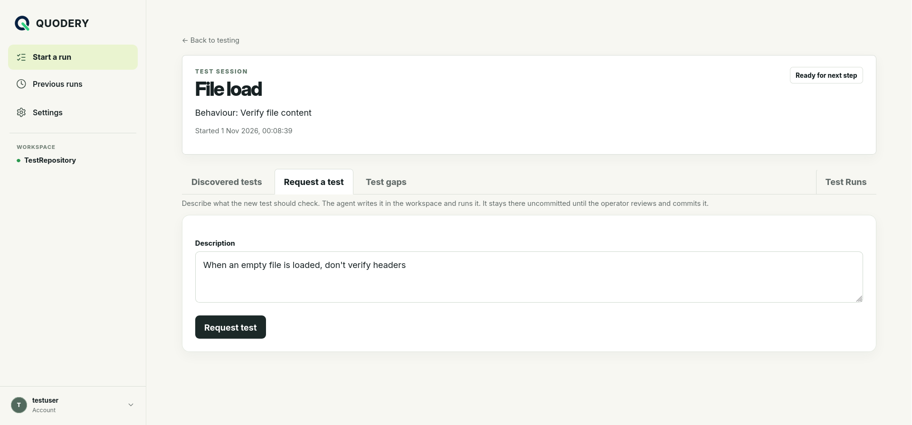

# Quodery

Quodery lets people run and request tests from a web UI without accessing the code directly. A runtime installed next to the code does the work with the team's coding agent, so the code never leaves that machine.



## Building the executable

You need a .NET 10 SDK (runtime 10.0.11 or newer).

```bash
git clone https://github.com/quodery/quodery && cd quodery
dotnet publish cli/Quodery.Cli.csproj --configuration Release -p:Version=0.1.1
```

This produces a self-contained single-file Linux x64 executable at `cli/bin/Release/net10.0/linux-x64/publish/quodery`. It needs no .NET on the target machine. `-p:Version` is required: the build fails without it.

## Three modes to run

Quodery is a single Linux executable:

| Command | What it is                                                                                                                                                          |
| --- |---------------------------------------------------------------------------------------------------------------------------------------------------------------------|
| `quodery runtime --serve` | **Serving runtime:** a runtime that also serves the web UI and accounts, all on one machine.                                                                        |
| `quodery runtime --server-url …` | **Standalone runtime:** runs next to the code and connects out to a remote server.                                                                                  |
| `quodery server` | **Server:** remote web UI, accounts and run history for a team. Serves HTTPS with your certificate or runs behind a reverse proxy. |

### Serving Runtime Mode

```bash
quodery runtime --serve --workspace-root ~/code/shop --agent-provider claude
```

It prints a one-time setup link for the administrator account and creates a workspace connected to that directory. It listens on port 8080 on every interface; add `--address 127.0.0.1` to keep it local, or `--tls-certificate` and `--tls-key` to serve HTTPS.

### Server Mode

```bash
quodery server --tls-certificate /etc/quodery/fullchain.pem --tls-key /etc/quodery/privkey.pem
```

It listens on 443 (or plain HTTP on 8080 without a certificate) and prints a setup link on first start. For each workspace, the setup page generates the runtime command:

### Standalone Runtime

```bash
export QUODERY_RUNTIME_KEY="<runtime-key-from-the-setup-page>"
quodery runtime --server-url https://quodery.example.com/runtime --workspace-root ~/code/shop --agent-provider claude
```
### Command-line options

Values are separate arguments (no `--option=value`), case-sensitive; unknown options are rejected, as are duplicate or empty runtime options. There's no settings file or environment-variable equivalent, except `QUODERY_RUNTIME_KEY` for a standalone runtime. `quodery --version` prints the version.

| Option | Server | Runtime | Default | Purpose                                                                                                                            |
| --- | :---: | :---: | --- |------------------------------------------------------------------------------------------------------------------------------------|
| `--server-url <url>` **or** `--serve` |  | ✓ | Required: exactly one | `--server-url`: a standalone runtime connecting to a remote server.<br>`--serve`: a serving runtime that also provides the web UI. |
| `--workspace-root <path>` |  | ✓ | Current directory | Workspace the agent runs in.                                                                                                       |
| `--agent-provider <provider>` |  | ✓ | `codex` | `codex` or `claude`.                                                                                                               |
| `--agent-binary <path>` |  | ✓ | `codex` or `claude` | Agent executable name or path.                                                                                                     |
| `--timeout-seconds <seconds>` |  | ✓ | `600` | Limit for each non-discovery job.                                                                                                  |
| `--catalogue-timeout-seconds <seconds>` |  | ✓ | `600` | Limit for test discovery, 1–3600.                                                                                                  |
| `--allow-git` |  | ✓ | Off | Let web users switch branch, get the latest changes, and commit or discard uncommitted changes. Requires a Git repository.         |
| `--unsafe-log-agent-io` |  | ✓ | Off | Log redacted agent output locally. May expose workspace data and secrets.                                                          |
| `--address <ip>` | ✓ | With `--serve` | Every interface | Address to listen on.                                                                                                              |
| `--port <port>` | ✓ | With `--serve` | `443` with a certificate, otherwise `8080` | Port to listen on.                                                                                                                 |
| `--tls-certificate <pem>` | ✓ | With `--serve` | — | Certificate (full chain) for HTTPS; requires `--tls-key`. Read at startup: restart after replacing it.                             |
| `--tls-key <pem>` | ✓ | With `--serve` | — | Private key of the certificate.                                                                                                    |
| `--http-port <port>` | ✓ | With `--serve` | — | With a certificate, also listen for plain HTTP and redirect it to HTTPS.                                                           |
| `-h`, `--help` | ✓ | ✓ | — | Print help.                                                                                                                        |

### Session data and logging

Each run gets `~/.quodery/runtime/<yyyyMMddHHmmss>/` with `session.log` and `session-reports/ses_<id>.json`. Logs exclude agent output unless `--unsafe-log-agent-io` is set. Reports hold local execution details (used by **Investigate failure**), are never uploaded, and are never deleted automatically. Proposed new tests are kept beside them as `ses_<id>.proposal.json` until the server has received their outcome.

## Set up the coding agent

The runtime starts the agent non-interactively in the workspace with your existing agent configuration and adds no permission flags. Model, approvals, sandbox and network access are the agent's own configuration; Quodery users can't change them. Nothing can approve a prompt, so anything not allowed up front is refused and the job ends with **could not run**. To run tests, the agent needs permission to run the build and test commands, and network access if required.
 
## Adding implementation for a new coding agent

Agents are subclasses of `CliAgentAdapter` (`runtime/Agent/CliAgentAdapter.cs`), which owns timeouts, cancellation, clarifying questions, checkpoints, reports, the Git change check and logging. A new adapter, like `ClaudeAgentAdapter.cs` or `CodexAgentAdapter.cs`, overrides:

- `ProviderName`: the `--agent-provider` value (and capability, such as `agent.claude`).
- `BuildStartInfo(threadId, schemaFile)`: the non-interactive command line from `CreateStartInfo()`, requiring a final report matching `Agent/<schemaFile>` and resuming `threadId` when set. Leave permissions to the agent's configuration.
- `ReadOutput(root)`: map each JSON output line to a `CliAgentOutput` (`ThreadId`, `Message`, `ToolActivity`, `Final`, `Failed`, or empty).

Then wire it into `AgentProvider`, `runtime/Configuration.cs`, `runtime/RuntimeCommand.cs`, the default `--agent-binary`, and `web/Pages/Setup.cshtml(.cs)`.

